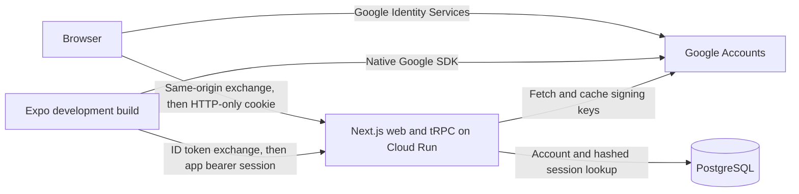

# Account architecture

The API verifies the ID token's signature, issuer, audience and expiry, then upserts the profile by Google's stable subject. PostgreSQL stores an app UUID and a SHA-256 digest of each random session token. The API checks the session expiry on every protected request. Account deletion cascades to all of that account's sessions. A later sign-in creates a new app account.
